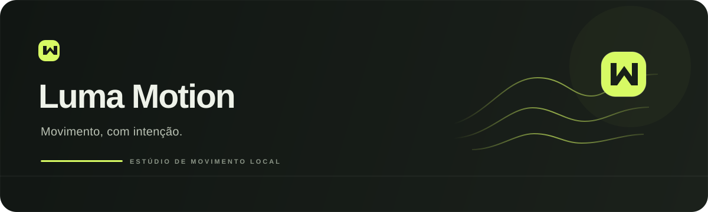

<div align="center">
  
</div>

<div align="center">
  
  
  
  
</div>

<br>

> **Motion blur local para vídeo.** Um estúdio desktop em Rust, feito para criar rastros de movimento ajustáveis e continuar a edição no seu fluxo normal.

## O projeto

Luma Motion combina um motor original de motion blur com uma interface de estúdio para Windows. Importe um clipe, escolha um ponto de partida, gere uma prévia e exporte o resultado. O processamento acontece no computador.

A interface separa os ajustes **Básicos** dos **Avançados**, salva suas preferências e permite guardar e compartilhar presets `.luma.json`. O visual foi pensado para o Luma Motion; `f0e/blur` serviu de referência conceitual, sem código ou interface copiados.

## O que dá para fazer

| | |
|:--|:--|
| **Ajustar o movimento** | Controle o ângulo do shutter, a proteção contra artefatos e a distribuição de até 15 amostras. |
| **Escolher onde processar** | Use Rayon na CPU ou estime movimento e integre o blur em shaders WGSL na GPU com `wgpu`. |
| **Codificar seu vídeo** | Exporte MP4/H.264 ou MOV/ProRes 422 HQ. Para MP4, escolha libx264 ou NVIDIA NVENC quando disponível. |
| **Comprimir em HEVC** | Escolha máxima fidelidade ou compressão intensa. Aplique o blur e comprima em uma passada, ou use **Só comprimir** para pular o processamento de imagem. |
| **Mudar a cadência** | Mantenha o FPS de origem ou reamostre para 24, 30, 60 ou 120 fps. O FFmpeg interpola os quadros quando solicitado. |
| **Continuar a edição** | Aplique nitidez, brilho, contraste, saturação e controle de áudio. Exporte e leve o arquivo ao seu editor. |

O motor de blur não usa RIFE, SVP ou modelos de IA. A interpolação para 120 fps usa o filtro `minterpolate` do FFmpeg e continua sendo uma etapa separada do blur.

## A interface

<div align="center">
  
</div>

A janela tem uma barra própria, tema escuro, navegação entre Estúdio e Configurações e prévia com comparação original/resultado. O tema claro também está disponível. O monitor mantém o vídeo ao trocar de aba.

## Começar no Windows

**Para abrir a versão compilada**, deixe `Luma Motion 0.5.exe` e a pasta `bin` lado a lado. O executável procura `ffmpeg.exe` e `ffprobe.exe` nessa pasta; caso não estejam lá, procura no `PATH`. A janela precisa do WebView2 Runtime, incluído na maioria das instalações atuais do Windows.

**Para compilar a partir do código**, instale Rust stable, a toolchain MSVC do Visual Studio e FFmpeg com `ffmpeg` e `ffprobe` disponíveis no `PATH`. No PowerShell:

```powershell
git clone https://github.com/GuiiDEV1/luma-motion.git
cd luma-motion
cargo build --release
.\target\release\luma-motion.exe

```

Para abrir o modo web local, use `Abrir Web.cmd` ou execute:

```powershell
.\target\release\luma-motion.exe --web

```

O modo web escuta somente em `127.0.0.1`. O modo desktop tenta a porta 8765 e escolhe uma porta local livre se ela já estiver em uso.

### Criar um pacote Windows

Com FFmpeg e ffprobe disponíveis no `PATH`, execute:

```powershell
.\scripts\package.ps1
```

O pacote fica em `dist/`. Para facilitar o download do código, binários compilados e FFmpeg **não** fazem parte deste repositório; distribua o FFmpeg separadamente, com a licença correspondente à build utilizada.

## Configurações que vale conhecer

- **Modo Básico:** presets Clean, Smooth e Cinema, intensidade, proteção, FPS e formato de saída.
- **Modo Avançado:** amostras, resolução e alcance da busca de movimento, pesos, gamma, nitidez, ajustes de cor, áudio, preset do encoder e duração da prévia.
- **Compressor:** fidelidade prioriza preservar detalhes; o modo intenso usa mais compressão e pode mostrar perda de detalhes. Ambos usam HEVC, mantêm resolução e FPS e podem ser codificados na CPU ou com HEVC NVENC em GPUs compatíveis.
- **Só comprimir:** codifica a fonte diretamente para HEVC sem calcular blur, interpolar FPS ou aplicar ajustes de imagem.
- **Presets:** exporte e importe configurações em JSON. Vídeos e caminhos locais não fazem parte do preset; formatos antigos usam valores padrão para as opções novas.

HEVC é um formato com perdas. O modo de fidelidade reduz a perda visual, mas não garante compressão sem perdas nem um arquivo menor para toda fonte. A reprodução de HEVC depende do player utilizado.

## Como o motor trabalha

A CPU usa Rayon para buscar correspondências entre blocos e misturar amostras na direção do movimento. A GPU executa a busca e a integração com shaders WGSL. O quadro anterior permanece nos buffers da placa durante o processamento GPU, o que reduz cópias entre os quadros. Uma verificação de cortes reduz rastros entre cenas distintas.

Uma otimização adicional envia frames diretamente do FFmpeg ao encoder quando o shutter está zerado ou a ação é apenas compressão. Isso evita movimentar frames brutos por Rust quando nenhum cálculo de blur é necessário.

### Medição de desempenho

Em um clipe de teste 1080p/60 de 2 segundos, com shutter 180°, 15 amostras, análise a 720 px e raio 24, o tempo total com GPU + NVENC caiu de **4,91 s na versão 0.4 para 3,19 s na 0.5** (aproximadamente 35% menos nesse teste). Outro ensaio, só de codificação HEVC NVENC, terminou em **1,29 s** no modo fidelidade e **0,80 s** no intenso. Desempenho depende da fonte, configurações e hardware; vídeos maiores e interpolação de FPS demoram mais. São medições locais, não garantias de tempo.

## Limites conhecidos

Vídeos SDR até 4K e 240 fps são aceitos. HDR ainda precisa ser convertido para SDR. A análise de movimento tem alcance configurável, por isso objetos rápidos, oclusões, texto em movimento e movimentos que excedam a busca podem gerar artefatos. A proteção contra cortes é conservadora, não um detector perfeito. O modo GPU acelera o cálculo do blur, enquanto a interpolação de quadros continua na CPU.

Arquivos de vídeo, exportações e logs do app desktop ficam em `%LOCALAPPDATA%/LumaMotion/workspace`. A configuração do aplicativo fica em `%LOCALAPPDATA%/LumaMotion/config.json`. No modo web local, os dados ficam na pasta de trabalho atual.

## Estrutura

```text
src/        motor Rust, API local, GPU e shaders WGSL
web/        interface do estúdio, ícones e configurações
assets/     recursos do Windows
scripts/    criação do pacote e ferramentas de validação
examples/   preset de exemplo para importar
docs/       identidade visual do README
```

## Desenvolvimento

```powershell
cargo run --release
cargo clippy --all-targets -- -D warnings
node scripts/configs-test.cjs
```

Os testes de API e vídeo precisam do aplicativo em execução, além de FFmpeg/ffprobe. `scripts/smoke.mjs` também utiliza `test-input.mp4`, que é um arquivo local de teste e não está incluído.

O código deste repositório é disponibilizado sem uma licença aberta definida. Consulte o proprietário antes de reutilizar ou redistribuir o código.

<div align="center">
  <sub>Feito para o movimento. Ajustado por você.</sub>
</div>
